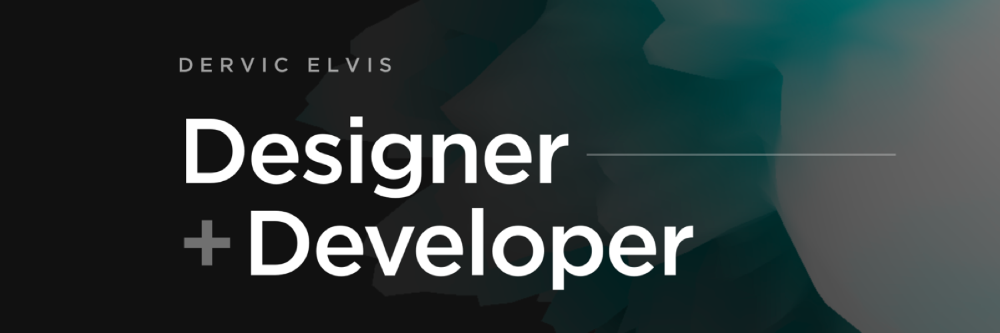

<!-- ═══════════════════════════════════════════════════════════════ -->
<!--   DERVIC DEV · GitHub Profile README                              -->
<!--   Accent: teal #2DD4BF · Background: #0D1117                     -->
<!-- ═══════════════════════════════════════════════════════════════ -->

<!-- 👇 banner.png must be uploaded in the root of this repository -->

<!-- Typing animation — edit the lines as you like -->

 

---

## 🛠 Tech Stack

<!-- Customize icons at: https://skillicons.dev -->

 

| **Frontend** | **Backend & Tools** | **Design** |
|:---:|:---:|:---:|
| HTML5 · CSS3 · JavaScript · React · Tailwind | Node.js · Git · GitHub | Figma · UI/UX · Prototyping |

